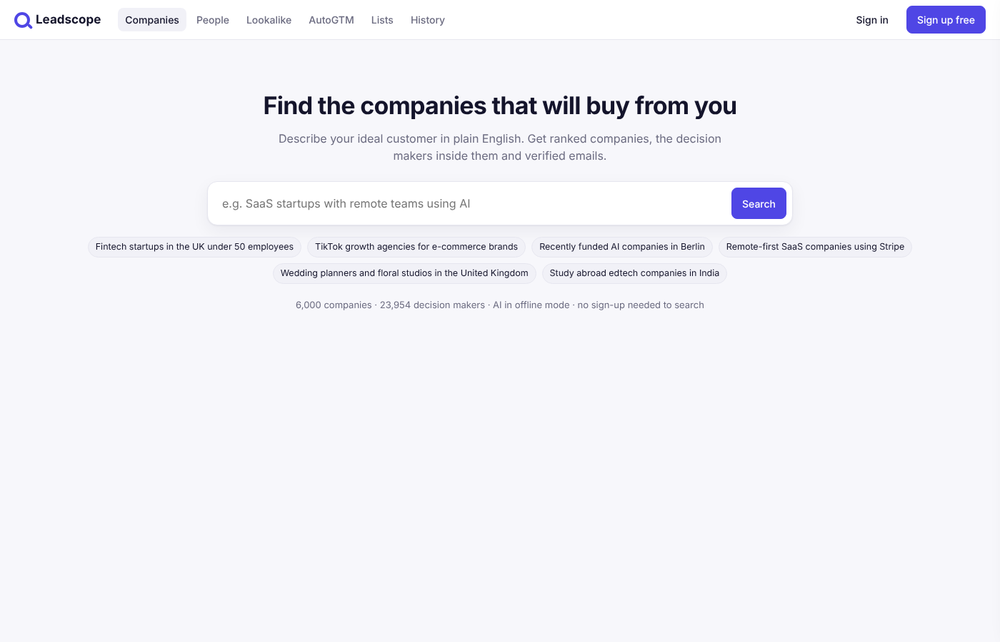
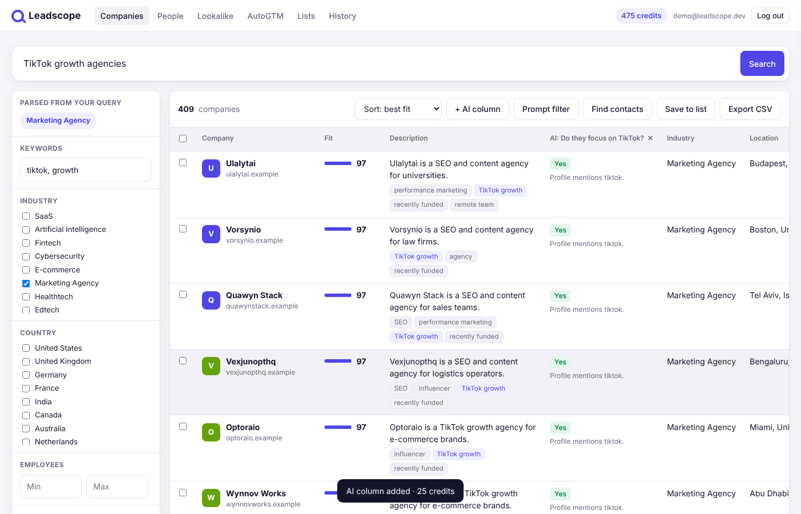
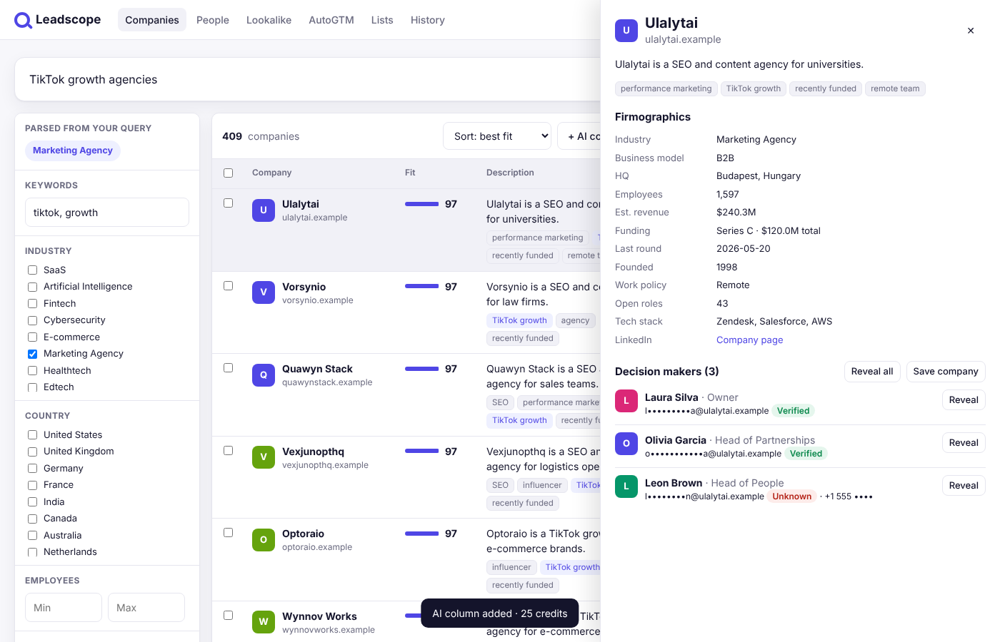
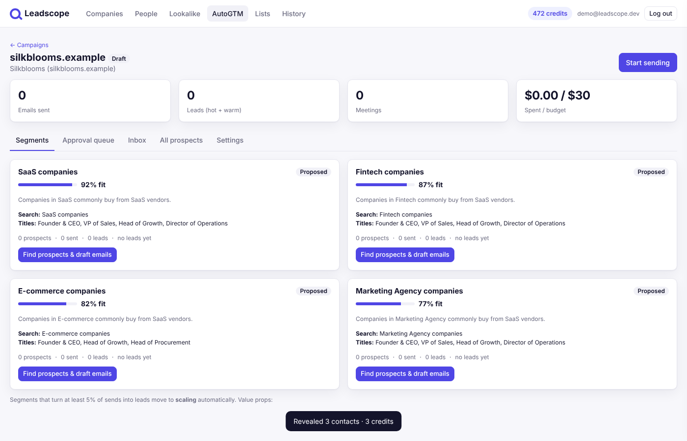
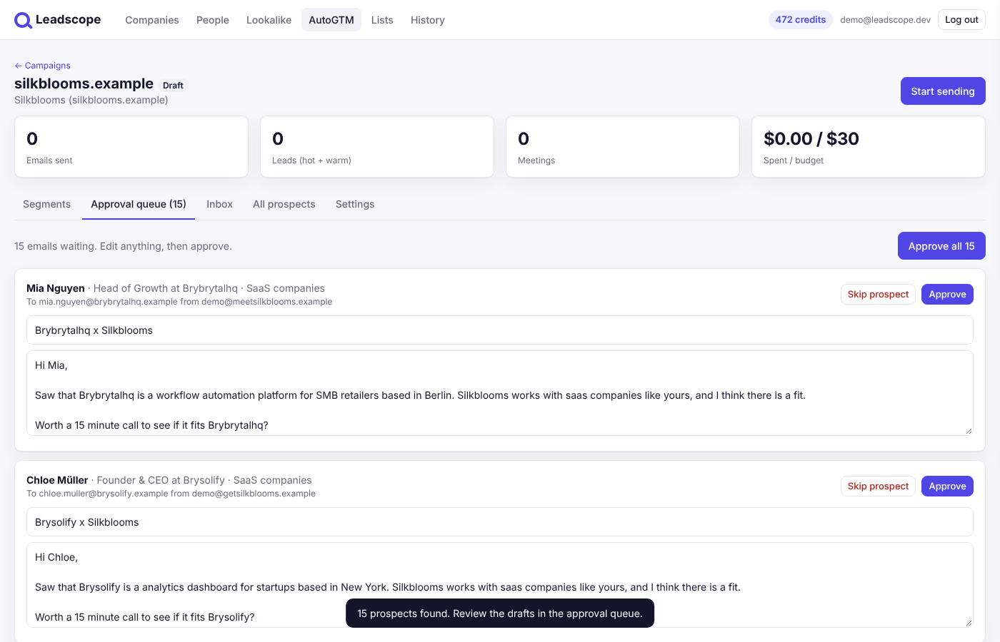
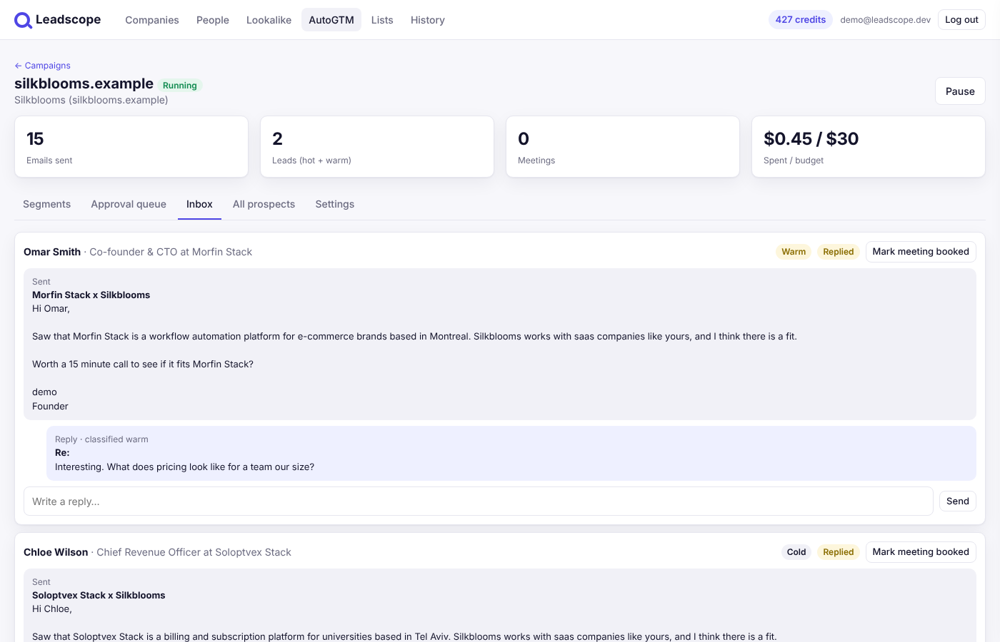

# Leadscope

AI company and people search, plus an outbound agent that books meetings. This is a working rebuild of the [Explee](https://explee.com) feature set under its own name.

- **Company search in plain English.** "Fintech startups in the UK under 50 employees" becomes structured filters you can edit, and results come back ranked by fit score. You can search without signing up.
- **AI columns.** Ask any yes/no question ("Do they sell on subscription?"). Every row gets yes, no or unsure plus a one-line reason. These columns export to CSV.
- **Prompt filter.** AI reads the top matches and keeps only the ones that fit your description.
- **Lookalikes.** Enter a customer's domain and get similar companies.
- **Decision makers.** People search by title, seniority, department and country. Emails are masked until you reveal them (1 credit each, charged once).
- **Lists, CSV export, search history, a credit wallet, plans and a ledger.**
- **AutoGTM.** Give it your website. It writes a product summary, ranks buyer segments by fit, finds one decision maker per company and drafts a personal email for each. **You approve before anything sends.** It then sends from separate warmed inboxes, drafts follow-ups, classifies replies and tracks leads, meetings and cost per lead per segment. Segments move to Scaling automatically.

## Run it

Requires Node 22.5 or newer.

```bash
npm install
```

```bash
npm start
```

Open http://localhost:3000. The first start seeds a synthetic dataset of 6,000 companies and about 24,000 people into `data/app.db`.

To turn on Claude for query parsing, AI columns, website analysis, email writing and reply classification:

```bash
ANTHROPIC_API_KEY=sk-ant-... npm start
```

Without a key, every AI feature falls back to built-in heuristics, so the whole app still works offline.

```bash
npm test
```

Runs 11 end-to-end API tests covering search, AI columns, reveals, lookalikes, lists, CSV, billing, the full AutoGTM approval-to-reply flow, budget caps and cross-user isolation.

## Configuration

| Variable | Default | Purpose |
|---|---|---|
| `PORT` | 3000 | HTTP port |
| `ANTHROPIC_API_KEY` | unset | Enables Claude |
| `CLAUDE_MODEL` | `claude-opus-5-5` | Model for all AI calls |
| `DB_PATH` | `data/app.db` | SQLite file |
| `GTM_TICK_MS` | 5000 | AutoGTM worker interval |
| `GTM_SIMULATE_REPLIES` | true | Demo replies. Set to `false` once real inboxes are connected |
| `GTM_SIM_REPLY_RATE` | 0.2 | Share of prospects that "reply" in demo mode |
| `GTM_REPLY_DELAY_MS` / `GTM_FOLLOWUP_AFTER_MS` | 15000 / 60000 | Demo timings |

## Read before you demo or ship

- The data is **synthetic**: every domain ends in `.example`. Real use needs a licensed data provider.
- Sending and replies are **simulated**. Cold-email compliance (unsubscribe, suppression list, GDPR/DPDP rules) isn't built yet.
- Payments run in **test mode**.

Details: [docs/RESEARCH.md](docs/RESEARCH.md) covers the Explee teardown, sources, feature-parity table and known gaps. [docs/ARCHITECTURE.md](docs/ARCHITECTURE.md) covers the schema, API and production swaps.

## Screens

| | |
|---|---|
|  |  |
|  |  |
|  |  |
